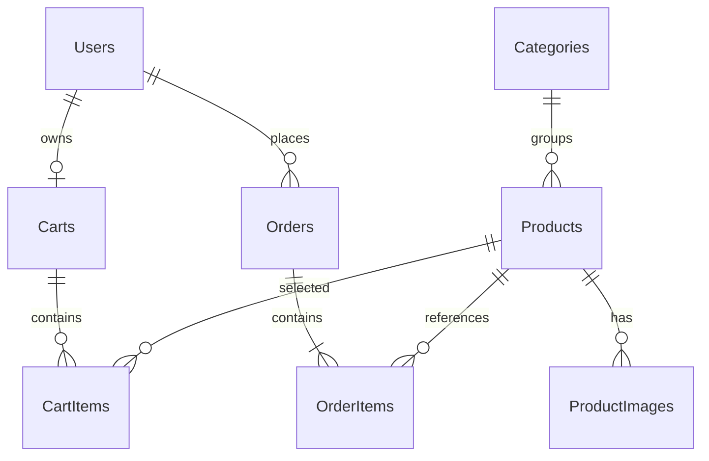

# Database dự kiến: CellphoneS_Testing

Chỉ đề xuất; chưa truy vấn được nội dung database và chưa thực thi SQL. Không tạo DB từ server startup. Trước khi chạy `database/schema.proposed.sql`, kiểm tra database/tables hiện hữu trong SSMS và được người dùng xác nhận. Script yêu cầu database đích đúng tên, chỉ tạo 8 bảng trong một transaction; không phải migration idempotent, không chạy lại trên schema đã có.

## Quan hệ



| Bảng | Nội dung và khóa |
|---|---|
| Users | Id PK; Email unique chuẩn hóa lowercase; FullName, PasswordHash, Phone nullable, Role CUSTOMER/ADMIN, IsActive, timestamps |
| Categories | Id PK; Slug unique; Name, IsActive |
| Products | Id PK; CategoryId FK; Sku và Slug unique; Name, Description, Price, Stock, IsActive, timestamps, Version rowversion |
| ProductImages | Id PK; ProductId FK; ImageUrl, AltText, SortOrder; unique(ProductId,SortOrder) |
| Carts | Id PK; UserId FK unique; tối đa một cart mỗi user; UpdatedAt |
| CartItems | Id PK; CartId/ProductId FK; unique(CartId,ProductId); Quantity 1–99 |
| Orders | Id PK; UserId FK; OrderCode unique; unique(UserId,RequestKey) chống tạo trùng; thông tin giao hàng snapshot, COD, status, total |
| OrderItems | Id PK; OrderId/ProductId FK; unique(OrderId,ProductId); snapshot tên/SKU/đơn giá; Quantity, LineTotal tính toán |

Tất cả PK INT IDENTITY. Chuỗi tiếng Việt NVARCHAR, tiền DECIMAL(18,2), thời gian DATETIME2(3) UTC. Role nằm trong Users để giữ đúng 8 bảng và thiết kế dễ hiểu. Không thêm Reviews/Brands/Roles ở phạm vi hiện tại.

## Ràng buộc và phân chia trách nhiệm

- FK mặc định NO ACTION, không cascade. Ngừng kinh doanh bằng IsActive=0, không xóa Products đã có lịch sử. Xóa cart items phải thực hiện có chủ đích.
- CHECK trong SQL: tên không rỗng, giá 0–9.999.999.999,99; tồn kho 0–1.000.000; quantity 1–99; phone Việt Nam 10 chữ số bắt đầu 0; rating không thuộc phạm vi này; status/COD theo tập giá trị.
- Email được trim/lowercase trước insert; SQL có unique và kiểm tra hình thức cơ bản; API kiểm tra email đầy đủ. SKU/slug trim và validate tại API; slug dùng ký tự ASCII thường, số, dấu gạch ngang.
- UpdatedAt không tự cập nhật khi UPDATE: repository phải đặt SYSUTCDATETIME(). Rowversion dùng phát hiện sửa sản phẩm đồng thời, không phải thời gian.
- Không thể bảo đảm tổng order bằng tổng items hoặc order có ít nhất một item bằng FK/CHECK đơn giản: service chịu trách nhiệm trong cùng transaction.
- Tồn kho của cart không được giữ chỗ. Checkout đọc lại giá/trạng thái, UPDATE stock có điều kiện Stock>=quantity, kiểm tra số dòng ảnh hưởng; tạo order/items, xóa cart items và commit cùng transaction, rollback toàn bộ nếu lỗi.
- Không giữ transaction trong lúc người dùng nhập form. Thứ tự cập nhật sản phẩm cố định và retry có giới hạn khi deadlock. RequestKey do client tạo cho một lần checkout, gửi lại dùng cùng key; server trả đơn đã tạo, không trừ tồn lần nữa.
- Tài khoản ứng dụng không có quyền tạo/xóa database; tài khoản DDL tách biệt. Index/unique trong SQL hỗ trợ FK và truy xuất theo user/category.

## Dữ liệu mẫu dự kiến và SSMS

Seed sẽ là bước riêng sau xác nhận, dùng script Node + mssql và hash thật. Chưa tạo INSERT/UPDATE hoặc seed tự chạy. Bộ dữ liệu: admin, hai customer; ít nhất hai category; sản phẩm còn 10 hàng, còn 1, hết hàng, ngừng bán, tên tiếng Việt và ảnh rỗng; giỏ rỗng/có hàng; order mẫu sau khi UC-06 hoàn tất. Mỗi dữ liệu có email/SKU tiền tố DEMO để seed lặp có kiểm soát, không xóa dữ liệu khác. Mật khẩu test lấy từ biến môi trường, không hardcode SQL.

SSMS: kết nối `.\SQLEXPRESS`, mở New Query, chỉ chạy SELECT xác minh trước. Sau khi triển khai và được phê duyệt, Refresh Tables, mở Columns/Keys/Constraints/Indexes và kiểm tra dữ liệu bằng SELECT (không Edit Top Rows).

```sql
SELECT SERVERPROPERTY('ProductVersion') AS Version, SERVERPROPERTY('Edition') AS Edition;
SELECT name FROM sys.databases WHERE name=N'CellphoneS_Testing';
-- Các truy vấn sau chỉ dùng sau khi database/schema đã tồn tại:
SELECT TOP (20) Id, Email, Role, IsActive FROM CellphoneS_Testing.dbo.Users;
SELECT TOP (20) Id, Sku, Name, Price, Stock, IsActive FROM CellphoneS_Testing.dbo.Products;
SELECT TOP (20) Id, OrderCode, UserId, TotalAmount FROM CellphoneS_Testing.dbo.Orders;
```
